<p align="center">
  
</p>

<h1 align="center">Wakeful</h1>

A free, open-source menu bar app that keeps your Mac awake, inspired by
[Amphetamine](https://apps.apple.com/us/app/amphetamine/id937984704). Start a
session with one click, or choose a duration.

Wakeful is an independent project and is not affiliated with Amphetamine or
its developer.

## Download

Get `Wakeful-<version>.dmg` from the
[latest release](https://github.com/aminealichaouche/wakeful/releases/latest),
open it and drag Wakeful to Applications. The app is ad-hoc signed rather than
signed with an Apple Developer ID, so the first time you open it macOS will
refuse. Go to System Settings → Privacy & Security and click **Open Anyway**.

## Features

Click the menu bar icon to open a panel styled after
[BetterDisplay](https://github.com/waydabber/BetterDisplay)'s menu. Clicking
buttons inside it never closes it; click anywhere else to dismiss it.

- **Session card** with a live countdown and a switch to start or end a session
- **Start a session**
  - Indefinitely
  - For 5–45 minutes or 1–24 hours (quick-pick chips)
  - For a custom duration, or until a specific date and time (inline controls)
  - While an app is running (ends when the app quits)
  - While a file is downloading (ends when the partial file is renamed or
    removed, or after it stops growing for 10 minutes)
- **Session options**, shown as round toggle buttons
  - Allow display sleep (keep only the system awake)
  - Allow sleep when the lid is closed (turn off for closed-lid mode)
  - Allow the screen saver after N minutes of inactivity
- **Settings** (a page that slides in): launch at login, start a session when
  Wakeful opens, notify when a session ends, check for updates automatically
  (off by default), screen saver delay, end the session on low battery
- **Check for Updates** button at the bottom of the menu

## Requirements

- macOS 13 Ventura or later
- Xcode command line tools (Swift 5.9+) to build

## Build and run

```sh
./scripts/build-app.sh      # produces build/Wakeful.app (universal, ad-hoc signed)
open build/Wakeful.app
```

Move `Wakeful.app` to `/Applications` before enabling **Launch at Login**.

The app icon is drawn in code by `scripts/make-icon.swift`. After changing it,
run `./scripts/make-icon.sh` to regenerate `Resources/AppIcon.icns`.

During development you can also run `swift run`. Notifications are disabled in
that mode because they need an app bundle.

## How it works

| Setting | Mechanism |
| --- | --- |
| Display stays on | IOKit assertion `PreventUserIdleDisplaySleep` |
| Allow display sleep | IOKit assertion `PreventUserIdleSystemSleep` instead |
| Closed-display mode | `sudo -n pmset -a disablesleep 1`, allowed by a one-time helper (see below) |
| Screen saver after N minutes | The display assertion blocks the screen saver, so Wakeful starts `ScreenSaverEngine` itself once you've been idle for N minutes |

You can see Wakeful's assertion with `pmset -g assertions`.

### Closed-display mode

Normal power assertions can't stop a MacBook from sleeping when the lid
closes, so this mode uses `pmset disablesleep`, which needs root.

**Your password is asked for once, never stored.** The first time you uncheck
*Allow system sleep when display is closed*, Wakeful installs
`/etc/sudoers.d/wakeful-<your uid>`, a rule that lets only your user run exactly these two
commands without a password:

```
/usr/bin/pmset -a disablesleep 0
/usr/bin/pmset -a disablesleep 1
```

After that, closed-display mode turns on and off with no prompts. To remove
the rule, use **Settings → Remove Closed-Display Helper…** or run
`sudo rm /etc/sudoers.d/wakeful-$(id -u)`.

Wakeful restores normal sleep when the session ends. A small watchdog process
also restores it if Wakeful crashes or is force-quit. If the Mac restarts
mid-session, sleep is restored the next time Wakeful launches. To restore it by
hand:

```sh
sudo pmset -a disablesleep 0
```

Keeping a closed laptop awake in a bag can overheat it. Consider setting
**End on Low Battery** under Settings.

## Releasing

Bump `CFBundleShortVersionString` (and `CFBundleVersion`) in
`Resources/Info.plist`, commit and push to `main`. The
[Release workflow](.github/workflows/release.yml) sees a version with no
release yet, runs the tests, builds the app and publishes release `v<version>`
with `Wakeful-<version>.dmg`, `Wakeful-<version>.zip` and `SHA256SUMS.txt`.
GitHub adds the source code archives itself. Pushes that don't change the
version do nothing.

To build the disk image locally, run `./scripts/build-app.sh` and then
`./scripts/make-dmg.sh`.

## Sharing the app (e.g. from a NAS)

Run `./scripts/release.sh`. It runs the tests, builds the app, and puts
`Wakeful-<version>.dmg`, `Wakeful-<version>.zip`, `Wakeful-<version>-src.zip`, `SHA256SUMS.txt` and
`VERSION.txt` in `Ready to NAS/`.
Before that, it moves the previous release to `Ready to NAS/old/<version>_<date>/`.
Set the version in `Resources/Info.plist` before releasing. Share the zip, not the raw `.app` folder, because
copying a bundle over SMB can strip permissions or add `._` files.

- The app is ad-hoc signed, not signed with an Apple Developer ID, so its
  signature doesn't prove who built it. Keep the share read-only for everyone
  but you, and compare the checksum after downloading:
  `shasum -a 256 Wakeful-<version>.zip`.
- After unzipping, `codesign --verify --deep --strict Wakeful.app` should print
  nothing.
- If macOS says the app "can't be opened", go to System Settings → Privacy &
  Security and click **Open Anyway**. Don't disable Gatekeeper.
- Only run one copy at a time (for example, not one from the NAS and another
  from /Applications), because they share closed-display state.

## Security notes

- Wakeful has no URL schemes, XPC services or document types, and it accepts
  no incoming connections.
- Its only network request is the update check: an HTTPS GET to
  `api.github.com/repos/aminealichaouche/wakeful/releases/latest`. It runs only
  when you click **Check for Updates**, or daily if you turn on **Check for
  Updates Automatically** (off by default). It sends no cookies or personal
  data, refuses redirects and caps the reply at 1 MB. GitHub sees your IP
  address, as with any website.
- The update check never downloads or runs anything. It only reads a version
  number, which must be digits and dots. **View Release** opens
  `github.com/aminealichaouche/wakeful/releases/tag/v<that version>` in your
  browser, and you install updates yourself.
- The only root actions are the one-time helper install and uninstall. They use
  fixed command text: no file name, app name or setting is ever inserted into
  them.
- The sudoers rule allows exactly `pmset -a disablesleep 0` and `1`, with no
  wildcards. A program running as your user could use it to keep the Mac awake,
  but nothing more.
- The app is signed with the hardened runtime, which blocks library injection.

## Tests

```sh
swift test                                  # unit + stress tests, safe to run anytime
WAKEFUL_PMSET_TESTS=1 swift test            # also toggles disablesleep for real (needs helper)
WAKEFUL_APP_TESTS=1 swift test              # launches build/Wakeful.app and quits it every way
WAKEFUL_NETWORK_TESTS=1 swift test          # makes the real update-check request to GitHub
```

The opt-in suites always restore normal sleep and your Wakeful settings when
they finish. Quit Wakeful before running `WAKEFUL_APP_TESTS`.

## Project layout

`Resources/` holds `Info.plist` and the app icon (`AppIcon.icns`, plus a
1024px `AppIcon.png` preview).

```
Sources/Wakeful/
  WakefulApp.swift          app entry point and menu bar item
  AppDelegate.swift         launch and quit handling
  MenuView.swift            the dropdown panel
  MenuComponents.swift      rows, chips, round toggles and buttons
  SessionManager.swift      sessions, timers and trigger checks
  PowerAssertion.swift      IOKit sleep assertions
  ClosedDisplayGuard.swift  closed-lid mode: one-time sudoers helper, pmset, watchdog
  DownloadWatcher.swift     "while file is downloading" sessions
  Dialogs.swift             download picker and alerts
  StatusIcon.swift          drawn menu bar icon
  Settings.swift            UserDefaults-backed preferences
  SystemInfo.swift          battery, idle time, screen saver, notifications
  UpdateChecker.swift       "Check for Updates" against GitHub releases
```

## License

MIT. See [LICENSE](LICENSE).
